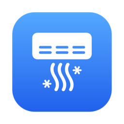
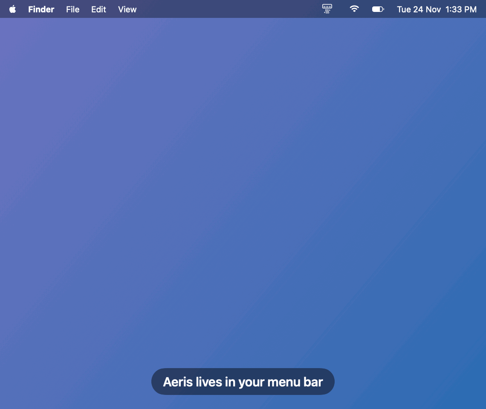
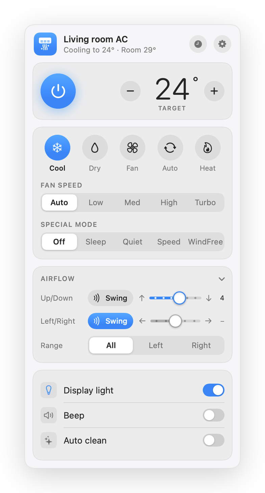
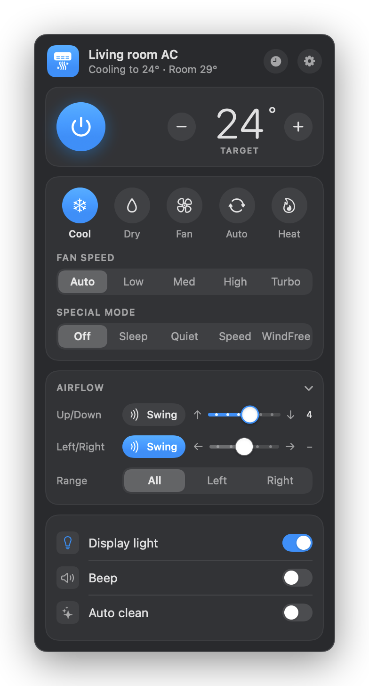

<p align="center">
  
</p>

<h1 align="center">Aeris</h1>

<p align="center"><strong>Your air conditioner, in the menu bar.</strong></p>

Aeris is a tiny macOS menu bar app for controlling a Samsung / SmartThings air conditioner.

```bash
brew install --cask kashmithnisakya/tap/aeris
```

or, without Homebrew:

```bash
curl -fsSL https://raw.githubusercontent.com/kashmithnisakya/aeris/main/install.sh | bash
```

Then [set it up](#set-up) with your SmartThings token. More options in [Install](#install).

<p align="center">
  
</p>

<p align="center">
  
  &nbsp;&nbsp;
  
</p>

<p align="center"><a href="https://raw.githubusercontent.com/kashmithnisakya/aeris/assets/demo.mp4">▶ Watch the demo video (MP4)</a></p>

Click the AC icon in the menu bar to turn it on or off, change the temperature, mode, fan speed,
swing and special modes (Sleep, Quiet, WindFree…). While the AC is on, the menu bar shows the
target temperature next to the icon.

On Samsung models that support it you can also aim the airflow (up/down and left/right swing or a
fixed angle), switch the display light, beep and auto-clean, and set **schedules** and a
**turn-off timer** that run in SmartThings even when your Mac is asleep.

- Native SwiftUI, no dependencies, ~1 MB
- Universal (Apple Silicon + Intel), macOS 13 Ventura or later
- Token stored in your macOS Keychain; the app only talks to `api.smartthings.com`
- Only shows the controls your AC actually supports

## Install

**Homebrew**

```bash
brew install --cask kashmithnisakya/tap/aeris
```

**Install script** (no Homebrew needed)

```bash
curl -fsSL https://raw.githubusercontent.com/kashmithnisakya/aeris/main/install.sh | bash
```

Both put **Aeris.app** in `/Applications` and launch it. Look for the AC icon in your menu bar.

<details>
<summary>Manual download</summary>

1. Download `Aeris.zip` from the [latest release](../../releases/latest) and unzip it.
2. Move **Aeris.app** to your Applications folder.
3. The app isn't notarized by Apple, so the first time **right-click it → Open → Open**.
   If macOS still refuses, run:
   ```bash
   xattr -dr com.apple.quarantine "/Applications/Aeris.app"
   ```

</details>

### Update

```bash
brew upgrade aeris                      # Homebrew
curl -fsSL https://raw.githubusercontent.com/kashmithnisakya/aeris/main/install.sh | bash   # script: re-run it
```

### Uninstall

```bash
brew uninstall --cask --zap aeris       # Homebrew
curl -fsSL https://raw.githubusercontent.com/kashmithnisakya/aeris/main/install.sh | bash -s -- --uninstall   # script
```

## Set up

Aeris signs in through SmartThings' official command-line tool, which is free and renews its login
by itself. You only sign in once.

1. Install the SmartThings CLI (once):
   ```bash
   brew install smartthingscommunity/smartthings/smartthings
   ```
2. Click the AC icon in the menu bar and press **Sign in with SmartThings**.
3. If a browser opens, log in to your Samsung account and allow access. Done.

The first air conditioner on your account is picked automatically. To choose another, open
⚙ Settings → Device. Tick **Launch at login** at the bottom of the panel to start Aeris with your Mac.

<details>
<summary>How sign-in works</summary>

The SmartThings CLI keeps its login in `~/Library/Application Support/@smartthings/cli/credentials.json`.
Aeris reads the current access token from there and calls the SmartThings API directly. Shortly before
the 24-hour token expires (or if SmartThings rejects it), Aeris runs `smartthings locations` in the
background so the CLI renews it. Aeris never uses or stores the CLI's refresh token.
Signing out in Aeris doesn't sign the CLI out.

If you don't use your Mac for about a month, SmartThings may ask you to sign in again.
</details>

<details>
<summary>Other ways to connect (advanced)</summary>

- **Your own SmartThings app.** With a SmartThings developer plan you can register an API Access app
  (`smartthings smartapps:create`, redirect URI `https://kashmithnisakya.github.io/aeris/callback/`,
  scopes `r:devices:*`, `x:devices:*`, `r:locations:*`) and paste its Client ID and Secret under
  ⚙ Settings → Advanced. Aeris then signs in with that app instead of the CLI.
- **Personal access token.** Paste a token from <https://account.smartthings.com/tokens> under
  ⚙ Settings → Advanced. SmartThings makes these expire after 24 hours.
</details>

## Build from source

```bash
swift run                      # run a debug build
scripts/build-app.sh 1.0.0     # build dist/Aeris.app and dist/Aeris-1.0.0.zip
```

## Demo media

Screenshots, the GIF and the video live on the [`assets`](../../tree/assets) branch so they don't bloat `main`.
Regenerate them with `scripts/make-demo.sh` (output in `dist/demo/`) and commit them to `assets`.

## Release

Add the version's notes to [`CHANGELOG.md`](CHANGELOG.md), merge, then push a tag. GitHub Actions
builds the app and publishes a GitHub release with that changelog section as its notes:

```bash
git tag v1.0.1 && git push origin v1.0.1
```

## License

MIT
